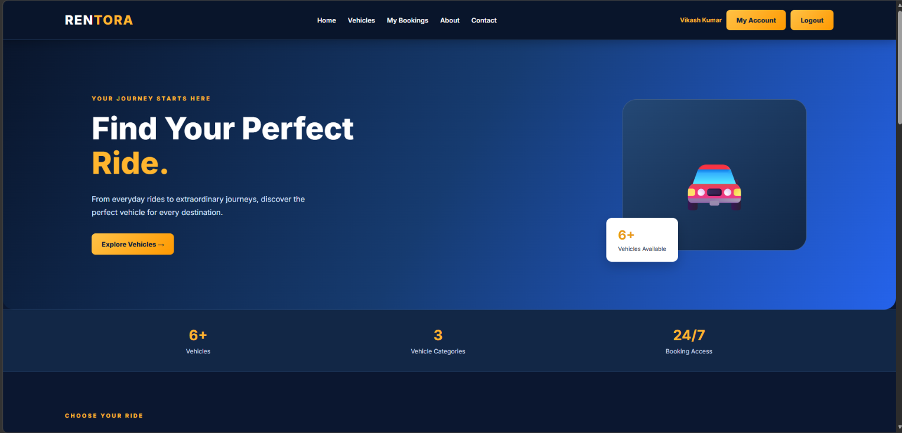
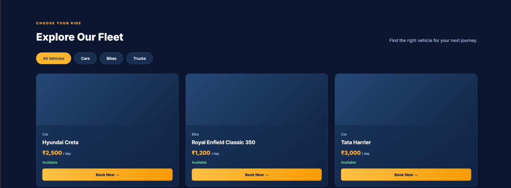
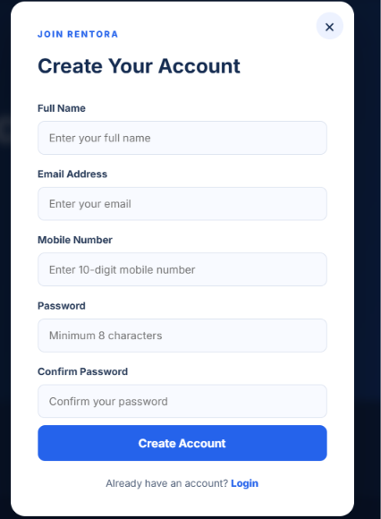
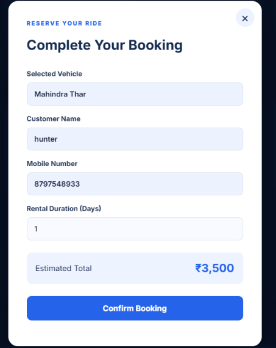
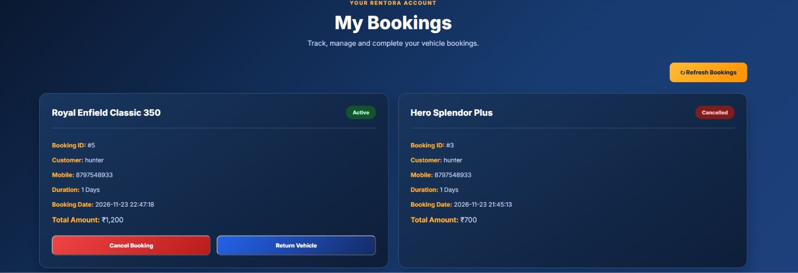
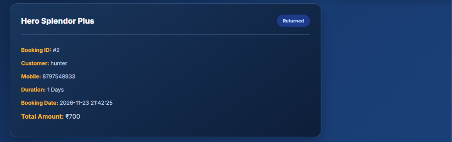

# 🚗 RENTORA – Smart Vehicle Rental System

### Your Journey, Your Vehicle, Your Way.

RENTORA is a web-based Smart Vehicle Rental System developed using **Scala 3** and **SQLite**. It provides users with a simple platform to explore vehicles, create accounts, book vehicles, and manage their bookings.

The project focuses on simplifying the vehicle rental process through an interactive interface and secure user authentication.

---

## 📸 Application Screenshots

### 1. Homepage


### 2. Vehicle Listings


### 3. Vehicle Categories and Filters


### 4. User Authentication


### 5. Vehicle Booking


### 6. My Bookings


### 7. Booking Status


---

## ✨ Features

- **User Registration:** Create a new account.
- **User Login:** Secure authentication system.
- **Password Security:** Passwords are hashed using PBKDF2WithHmacSHA256.
- **Vehicle Listings:** Browse available rental vehicles.
- **Vehicle Filtering:** Explore vehicles through categories.
- **Vehicle Booking:** Book vehicles for 1 to 30 days.
- **Automatic Price Calculation:** Calculate the total rental cost.
- **My Bookings:** View personal booking history.
- **Cancel Booking:** Cancel an eligible booking.
- **Return Vehicle:** Update an active booking as returned.
- **User Data Isolation:** Users can access only their own bookings.
- **Responsive Interface:** Modern dark-themed user interface.

---

## 🛠️ Technology Stack

| Technology | Purpose |
|---|---|
| Scala 3.10.1 | Backend development |
| Java 17 | JVM runtime |
| SQLite | Database management |
| SQLite JDBC | Database connectivity |
| HTML5 | Webpage structure |
| CSS3 | Styling and layout |
| JavaScript | Frontend interactions |
| Scala CLI | Compilation and execution |

---

## 🏗️ Project Structure

```text
Vehicle-Rental-System/
│
├── src/
│   └── main/
│       ├── scala/
│       │   └── Main.scala
│       │
│       └── resources/
│           └── static/
│               ├── index.html
│               ├── css/
│               │   └── style.css
│               └── js/
│                   └── app.js
│
├── screenshots/
│   ├── 01-homepage.png
│   ├── 02-vehicles.png
│   ├── 03-vehicle-filter.png
│   ├── 04-authentication.png
│   ├── 05-booking.png
│   ├── 06-my-bookings.png
│   └── 07-booking-status.png
│
├── .gitignore
└── README.md
```

---

## ⚙️ Installation and Setup

### Prerequisites

Make sure the following are installed:

- Java JDK 17
- Scala CLI
- Git

### Step 1: Clone the Repository

```bash
git clone https://github.com/invictussss/RENTORA.git
```

### Step 2: Open the Project Directory

```bash
cd RENTORA
```

### Step 3: Run the Application

```bash
scala-cli run src/main/scala/Main.scala
```

### Step 4: Open in Browser

Visit:

```text
http://localhost:8080
```

The application runs locally on port **8080**.

---

## 🗄️ Database Design

The application uses SQLite for persistent data storage.

The main database tables are:

| Table | Description |
|---|---|
| users | Stores registered user information |
| vehicles | Stores vehicle information |
| bookings | Stores vehicle booking records |

The database stores user accounts, vehicle details, and booking information.

**Note:** The local database file is excluded from GitHub to protect user information.

---

## 🔐 Security Features

- Password hashing using PBKDF2WithHmacSHA256.
- Random salt generation for password security.
- Session-based user authentication.
- Access control for user-specific bookings.
- Users can view and manage only their own bookings.

---

## 🚀 Future Enhancements

The following features can be considered for future development:

- Online payment gateway integration.
- SMS and email notifications.
- OTP-based verification.
- Advanced vehicle search.
- Admin dashboard.
- Booking confirmation notifications.

---

## 👨‍💻 Project Team

**Institution:** K.R. Mangalam University, Sohna, Gurugram  
**Course:** B.Tech CSE (Artificial Intelligence & Machine Learning)

| S. No. | Roll Number | Team Member |
|---|---|---|
| 1 | 2401730185 | VIKASH KUMAR |
| 2 | 2401730201 | ANKUSH SANGWAN |
| 3 | 2401730264 | PALAK KOHALI |
| 4 | 2401730152 | DEEPAK MAKKER |

---

## 📌 Project Information

- **Project Name:** RENTORA
- **Project Type:** Smart Vehicle Rental System
- **Programming Language:** Scala
- **Database:** SQLite
- **Repository:** [GitHub – RENTORA](https://github.com/invictussss/RENTORA)

---

### RENTORA – Your Journey, Your Vehicle, Your Way. 🚗
